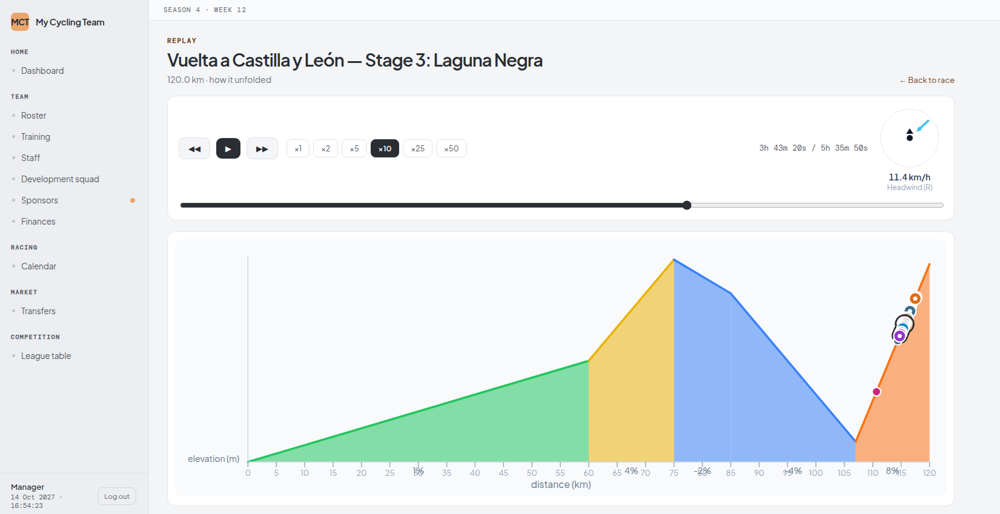
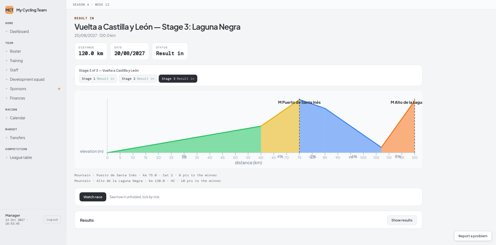
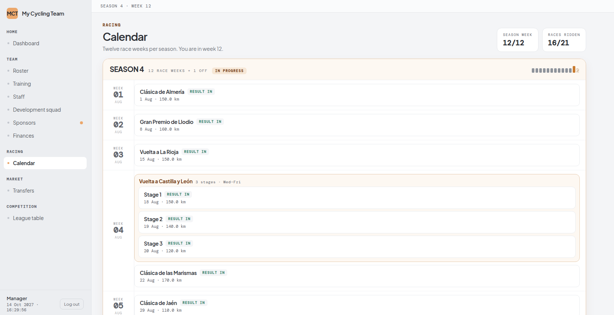

# Cycling Manager Game

An online multiplayer cycling management game. Build and manage a fictional
cycling team, then race it against other managers in leagues, stage races and
classics. Think Sokker, but for cycling.

The heart of the project is a **race engine** that simulates a bicycle race
second by second — drafting, fatigue, terrain, wind and team tactics all
resolved per rider, per tick — and a **race player** that visualises the result
like a TV broadcast.



| Race result | Season calendar |
|---|---|
|  |  |


## Why I built it

Two reasons: I want a cycling management game I'd enjoy playing, and I want
to know **how far agentic coding can go on a non-trivial product when the
human is the product owner and tech lead, and writes none of the code.**

## How it's built: Claude writes the code, I run the process

**All of the code is written by AI agents**, mostly
[Claude Code](https://claude.com/claude-code). My part is everything around it:

- **Deciding what to build.** I own the backlog, the issues and their
  priorities ([`specs/roadmap.md`](specs/roadmap.md)).
- **Approving the work.** I approve each spec and plan, and I review and merge
  every pull request.
- **Designing the workflow.** I designed the way the agents work, and it
  changes as I learn what fails.

The workflow is **spec → plan → code → review**. Each step is a Claude Code
skill in [`.claude/skills/`](.claude/skills/), and each moves the ticket along
the project board:

1. **`/product-spec`** writes what a feature does for the player, with no
   implementation detail ([`specs/`](specs/README.md)).
2. **`/tech-plan`** turns the spec into an implementation plan, split into work
   items.
3. **`/implement-plan`** builds the plan in its own git worktree, one commit per
   work item, and opens a pull request.
4. **`/code-review`** reviews that pull request in a fresh context, against the
   spec and the plan.

Finished specs and plans move to [`specs/archive/`](specs/archive/), so the
reasons behind each decision outlive the conversation that made them.

**In numbers:**

- About three months, from September to November 2026.
- About 900 commits and 70 merged pull requests.
- About 49k lines of Python and 19k lines of TypeScript.
- An 85% backend coverage floor in CI.

### What makes it work

- **Context on demand.** [`AGENTS.md`](AGENTS.md) is the only file an agent
  always loads, and it is an index. Each domain folder has a `README.md` that
  acts as that domain's spec. An agent reads only the README for the folder it
  is working in, so the context stays small as the project grows.
- **Hard boundaries.** The race engine never imports Django, and only
  `racing/adapters.py` may import the engine. Rules like this keep an agent's
  change from spreading across the codebase.
- **Parallel agents that don't collide.** Every git worktree gets its own
  database, test database and dev-server port, derived from its directory name
  ([`config/worktree.py`](config/worktree.py)). Several tickets can be built at
  once without one agent dropping another's test database.
- **AI beta testers.** Five LLM-driven managers, each with a persona and a
  diary, play the staging world on a schedule ([`beta_agents/`](beta_agents/README.md)).
  - They play through the public API, using tools generated from its OpenAPI
    schema.
  - They report anything that looks wrong through the same report-a-problem
    channel human players use.
- **Shipping on every merge.** Every merge to `master` that passes CI deploys
  the staging world to one Fly.io machine ([`deploy/`](deploy/README.md)).
  - The machine runs gunicorn, PostgreSQL and the tick scheduler.
  - The database is backed up nightly to Cloudflare R2.

## Prerequisites

| Requirement | Notes |
|---|---|
| **Python 3.12.11** | Pinned in `.python-version`. Install it with [pyenv](https://github.com/pyenv/pyenv) — see below. |
| **Node 20+ / npm** | Needed for the frontend and the race player. The Django API runs without it. |
| **Docker** | Runs the local PostgreSQL. `docker compose` ships with Docker Desktop and modern Docker Engine. |

### Python via pyenv

The project pins its Python version in `.python-version`, the same way a Node
project pins with `.nvmrc`. [pyenv](https://github.com/pyenv/pyenv) reads that
file and switches automatically when you `cd` into the directory.

pyenv compiles Python from source, so install the build headers first. On
Debian/Ubuntu:

```bash
sudo apt install build-essential libssl-dev zlib1g-dev libbz2-dev \
  libreadline-dev libsqlite3-dev liblzma-dev libffi-dev
```

Skipping those produces a Python that builds but is quietly missing modules
(`lzma`, `ctypes`, `readline`), which fails confusingly later.

Then, from the project root:

```bash
pyenv install          # reads .python-version, builds that exact version
```

It takes a few minutes — it is a real compile. Afterwards, `python` in this
directory is the pinned version.

**Not using pyenv?** Any Python 3.12 works — install it however you like and
make sure `python3.12` is on your `PATH`. On Debian/Ubuntu the stdlib `venv`
module is packaged separately, so you also need
`sudo apt install python3.12 python3.12-venv`; without it `python -m venv`
fails with `ensurepip is not available`.

## Getting started

```bash
python -m venv .venv
.venv/bin/pip install -r requirements.txt
docker compose up -d
.venv/bin/python manage.py migrate
.venv/bin/python manage.py runserver
```

Then open <http://127.0.0.1:8000/>.

Declare a season with:

```bash
.venv/bin/python manage.py load_season seasons/season-1.example.json
```

The example file declares a bare season with no races. A season's `races`
list — which week, day and course each race gets — is documented in
[`schedule/README.md`](schedule/README.md).

`python` there is whatever `.python-version` selects, so with pyenv set up you
get the pinned 3.12.11 without naming it. Without pyenv, use `python3.12`
explicitly.

To reach the Django admin at `/admin/`, create an account first:

```bash
.venv/bin/python manage.py createsuperuser
```

### The database

Development runs **PostgreSQL**, the same engine as production. That is
deliberate: SQLite quietly differs on JSON querying, constraint enforcement and
transaction behaviour, and those differences surface as bugs that only appear
after deploy.

`docker compose up -d` starts it — version-pinned, so every machine gets the
same Postgres. It listens on **port 5433** to avoid clashing with any Postgres
already installed natively on 5432. No configuration is needed; the defaults in
`config/settings/base.py` match the compose file.

```bash
docker compose up -d      # start it
docker compose down       # stop it, keeping the data
docker compose down -v    # stop it and wipe the data (start over)
```

To use a database of your own instead, set `POSTGRES_DB`, `POSTGRES_USER`,
`POSTGRES_PASSWORD`, `POSTGRES_HOST` or `POSTGRES_PORT` in the environment —
no settings file needs editing.

### Running the tests

```bash
.venv/bin/python -m pytest
```

This covers both the pure-Python engine and the Django apps. The database must
be up (`docker compose up -d`) — pytest creates and drops a separate test
database, so your development data is left alone.

In production the game runs on real time; `manage.py tick`, run hourly from
cron, finds and processes whatever has come due. In development, step a mock
clock forward deliberately with `manage.py mock_clock advance` and then run
`manage.py tick` — see [`world/README.md`](world/README.md).

## Continuous integration

A GitHub Actions workflow (`.github/workflows/ci.yml`) runs on every pull
request and on every push to `master`. It is split into two jobs:

- A fast job with no database — the `race_engine` tests plus the frontend's
  lint, tests and build — so a broken engine or frontend shows up in under a
  minute.
- A Postgres-backed job running the whole backend suite and measuring
  coverage, which fails if the number drops below 85%.

Reproduce the coverage measurement locally the same way CI does:

```bash
.venv/bin/python -m pytest --cov
```

A red check does **not** block merging — branch protection is not available on
this repository — so the discipline is manual: treat a failing check as a sign
to fix the branch before merging it.

## Simulating a race

The engine runs standalone, with no database and no web server:

```bash
.venv/bin/python -m race_engine race_engine/configs/mountain_stage.json --seed 42
```

It writes a `.jsonl` log into `race_player/public/`, which the visualizer reads.
`--seed` makes a run reproducible. Other bundled courses live in
`race_engine/configs/`.

**A warning about size:** these logs are big — one entry per rider per second,
tens of megabytes for a full race. They are gitignored build output; never
commit them. Slimming the format is planned work, written up in
[`racing/README.md`](racing/README.md).

## Viewing a race

```bash
cd race_player
npm install
npm run dev
```

The player loads logs from `race_player/public/`, so generate one first with the
command above. Details in [`race_player/README.md`](race_player/README.md).

## Project layout

Each domain is a Django app owning its own models, services and tests. Apps are
created when a feature needs one — an empty app is just noise.

| Folder | What it is | Status |
|---|---|---|
| [`race_engine/`](race_engine/README.md) | The simulation. Pure Python, no Django. | Built |
| [`race_player/`](race_player/README.md) | React visualizer for race logs. | Built |
| [`racing/`](racing/README.md) | The seam between Django and the engine. | Built |
| `core/` | Shared abstract models. | Built |
| [`accounts/`](accounts/README.md) | Player accounts and API tokens. | Built |
| [`riders/`](riders/README.md) | Persisted riders: attributes, speciality, age, development. | Built |
| [`teams/`](teams/README.md) | Teams, and claiming or losing one. | Built |
| [`schedule/`](schedule/README.md) | Seasons, weeks and the race calendar. | Built |
| [`competitions/`](competitions/README.md) | Race points and season standings. | Built |
| [`transfers/`](transfers/README.md) | The free-agent market and rider sales. | Built |
| [`economy/`](economy/README.md) | The append-only ledger every balance is derived from. | Built |
| [`staff/`](staff/README.md) | Trainers: the hiring pool and a team's slot. | Built |
| [`feedback/`](feedback/README.md) | Problem reports from beta testers, human or AI. | Built |
| `config/` | Django project: settings, URLs, WSGI. | Built |
| [`world/`](world/README.md) | The game clock and the tick. | Built |
| [`api/`](api/README.md) | DRF routers aggregating each app's serializers and views. | Built |
| [`frontend/`](frontend/README.md) | The React SPA, served by Django. | Built |
| [`beta_agents/`](beta_agents/README.md) | The LLM beta testers. Talks to the game only over HTTP. | Built |
| [`deploy/`](deploy/README.md) | The Fly.io image, backups and runbook. | Built |
| [`design/`](design/README.md) | UI mockups: reference, not source. | — |
| [`specs/`](specs/README.md) | Product-level feature definitions and plans. | — |

### Two rules worth knowing up front

**The race engine never imports Django.** It is plain dataclasses, so it stays
fast in its innermost loop, testable without a database, and free to change
without migrations. The only module allowed to import it is
`racing/adapters.py`, which translates between ORM rows and engine dataclasses.
The reasoning is in [`racing/README.md`](racing/README.md).

**Every domain folder documents itself.** Before working in one, read that
folder's `README.md` — and only that one. Engine internals are irrelevant when
styling the player, and vice versa.

## Configuration

Settings are split by environment:

- `config/settings/base.py` — shared
- `config/settings/dev.py` — `DEBUG = True`, local Postgres defaults (the default)
- `config/settings/prod.py` — PostgreSQL, driven entirely by environment
  variables (`DJANGO_SECRET_KEY`, `POSTGRES_*`, `DJANGO_ALLOWED_HOSTS`)

`manage.py` defaults to the dev settings. For production, set
`DJANGO_SETTINGS_MODULE=config.settings.prod`.

## Contributing

The order of work is **spec → plan → code**. A spec says *what* a feature does
for the player ([`specs/`](specs/README.md)); its `<slug>-plan.md` says *how*;
code comes last. See [How it's built](#how-its-built-claude-writes-the-code-i-run-the-process).

[`AGENTS.md`](AGENTS.md) is the index for coding agents — it explains the
documentation layout and the dependency rules between apps.
